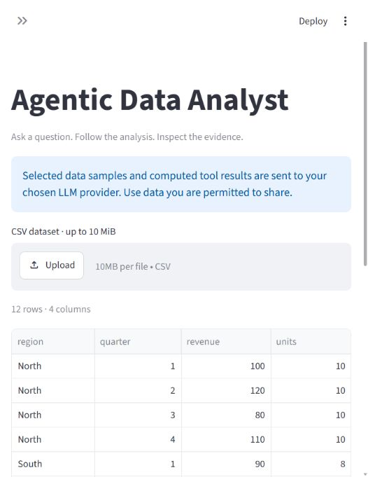
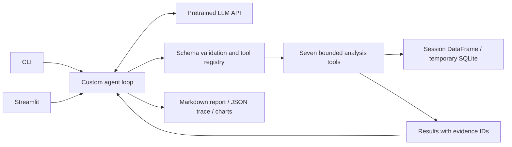

# Agentic Data Analyst

A small Python agent that chooses analytical tools dynamically, executes them,
observes results, repairs recoverable errors, and writes a report with evidence
references. Uses a pretrained LLM API; no training, fine-tuning or predictive models.

**Status:** implemented locally with CLI, Streamlit UI, seven analysis tools,
test suite and a 36-task benchmark. Live LLM evaluation and public deployment
have not been performed. Offline results are not agent accuracy.

Local verification: **31 tests passed**, **30/30 applicable offline tool checks
passed**, and the app's health endpoint returned HTTP 200. The sample-data view
was inspected in the browser.



## Quick start

Python 3.13 was used locally. From the project folder:

```powershell
python -m venv .venv
.\.venv\Scripts\python -m pip install -r requirements-dev.txt
Copy-Item .env.example .env
```

Edit `.env` locally: set `LLM_API_KEY`, `LLM_MODEL`, and optionally
`LLM_BASE_URL` for an HTTPS OpenAI-compatible Chat Completions provider.
Choose a model that supports function calling and `max_tokens`.
Never commit the key. Other provider protocols need a different client adapter.

```powershell
.\.venv\Scripts\python cli.py --file data/sales.csv --question "For each region, calculate the revenue change from Q2 to Q3. Which had the largest decline?"
.\.venv\Scripts\python -m streamlit run app.py
```

On macOS/Linux, use `.venv/bin/python`. The CLI loads `.env`. The web UI asks for
the visitor's own key and model; the server administrator controls the endpoint
with `LLM_BASE_URL`. The public app does not spend a shared owner key.

Reports, complete traces and charts go under `outputs/` for CLI runs. The web UI
provides report/chart downloads and keeps session data in memory and temporary
chart files. A session lasts at most ten questions.

## Demo walkthrough

1. Open the Streamlit app and upload `data/sales.csv`.
2. Enter a provider key and tool-calling model.
3. Ask the Q2-to-Q3 question above.
4. Inspect the action log and evidence cited in the report.
5. Ask “Create a bar chart of mean revenue by region.”
6. Download the report and chart.

The synthetic sales data's Q2→Q3 changes are North −40, South −5, West −40;
the percentage changes are −33.33%, −5%, and −36.36%. These are dataset
ground truth, **not a claim about an observed live model answer**.

Other examples: “Report Welch's p-value comparing score between control and
treatment” on `experiments.csv`; “How many durations are missing?” on
`operations.csv`; “Can these data establish why the change happened?”

## Multiple CSVs and optional schema

Upload up to 10 CSVs together, then optionally upload a JSON schema. Filenames
become lowercase SQL table names, with punctuation replaced by underscores.
For example, `customers.csv` becomes `customers`. Colliding names are rejected.
The interface previews each table. Changing files or schema resets conversation
history so evidence cannot accidentally refer to an earlier dataset.

Try `data/multi/customers.csv`, `data/multi/orders.csv` and
[`data/multi/schema.json`](data/multi/schema.json). Ask:
“Join orders to customers and calculate total revenue by region. Make a chart.”
Ground truth: North = 170 USD, South = 80 USD.

```powershell
.\.venv\Scripts\python cli.py --file data/multi/customers.csv data/multi/orders.csv --schema data/multi/schema.json --question "What is total revenue by customer region?"
```

The schema is JSON metadata, not SQL DDL. It can declare table/column descriptions,
column types (`string`, `integer`, `number`, `boolean`), nullability, primary keys
(including composite keys), and single-column many-to-one relationships.
Declared types are applied while reading CSVs; declaring an ID as `string` preserves
leading zeros. Invalid types, missing columns, duplicate/null primary keys, nonunique
relationship targets and unmatched foreign keys are rejected. Omitted columns/types
are inferred. Dates can be declared strings and interpreted explicitly in SQL.

The agent discovers all tables/schema through `inspect_dataset`, selects a `table`
for ordinary tools, and uses read-only SQL joins across tables. Chart/statistical
tools also accept `source_query` for joined results, limited to 5,000 rows without
silent truncation. All arguments and results remain in the evidence log.

Schema describes how tables relate; it cannot guarantee a statistically valid
analysis or prevent every double-counting mistake. The prompt asks the model to
check join grain; live cross-table model performance still needs evaluation.

## Architecture



| Component | Purpose |
|---|---|
| `agent/loop.py` | Reason/action/observation cycle, finish validation, limits and error recovery |
| `agent/llm_client.py` | HTTP provider boundary, transient retries, token usage |
| `agent/state.py` | Conversation history and per-run metrics |
| `tools/registry.py` | JSON Schema validation and structured errors |
| `tools/analysis.py` | Seven bounded analytical operations |
| `tools/dataset.py` | CSV size/dimension checks and missing/infinite-value handling |
| `evaluation/` | Reproducible tasks, offline checks and live baseline runner |

Tools: `inspect_dataset`, `describe_data`, `filter_data`, `aggregate_data`,
`run_sql`, `statistical_test`, `create_chart`. `finish` is a separate control tool.
There is no hardcoded analytical sequence, arbitrary Python executor, model training,
MCP server, separate web backend, or framework-managed agent loop.

Read [architecture decisions](docs/architecture.md) for the reference study and
tradeoffs, and [interview preparation](docs/interview-preparation.md) for a code-based
explanation of each design decision.

## Verification and evaluation

```powershell
.\.venv\Scripts\python -m pytest tests -q
.\.venv\Scripts\python -m evaluation.build_tasks
.\.venv\Scripts\python -m evaluation.benchmark
```

[Recorded offline results](evaluation/results/offline.json) check 30 tool oracles
across 36 tasks. Six conversational tasks require a live model. Unit tests explicitly
use scripted clients or mocked HTTP transport.

Once credentials are configured:

```powershell
.\.venv\Scripts\python -m evaluation.benchmark --mode live --system agent --output evaluation/results/live-agent.json
.\.venv\Scripts\python -m evaluation.benchmark --mode live --system single-shot-sql --output evaluation/results/live-baseline.json
```

Each command makes paid API requests when your provider charges. Use `--limit 2`
for a small first run. Set a provider-side spending limit.
Read the [grading protocol](evaluation/README.md) before interpreting results.
Automatic numerical screens are provisional; manually review claims and their
evidence before publishing task success rates.

## Limits and known gaps

- Files: CSV only, up to 10 files, 10 MiB each and 20 MiB combined; 100,000 rows
  combined, 100 columns per file, 2,000 characters per cell. Optional schema: 64 KB.
- Per question: 12 model steps by default, 32 tool calls, three consecutive tool
  failures, 160,000 serialized context characters, and a 50,000 reported-token
  stopping threshold. Token checks occur between requests, so this is not a strict
  dollar or token reservation system. API output is capped at 1,800 tokens/request.
- SQL uses an in-memory database, authorizer, query-only mode, two-second SQLite
  execution deadline, and bounded returned rows. File attachments and writes are rejected.
- Statistical tools report assumptions. They cannot verify independence or establish
  causality. Multiple-testing correction is not automatic.
- Evidence IDs are validated. **Citation validity does not prove numerical or
  semantic correctness of prose.** The live benchmark requires manual grading.
- No automatic pruning of context: the system stops instead of dropping tool
  evidence or breaking call/result pairs.
- Only successful API response usage is measured. Retries may add provider costs.
- Public multi-user scale and adversarial load have not been tested. CSV parsing and
  all numerical operations are not isolated in separate worker processes.
- The model sees sample rows and returned observations. Use permitted data.

## Deployment and portfolio

[Deployment guide](docs/deployment.md) includes the Streamlit Community Cloud
entrypoint, runtime, dependencies, configuration and verification steps.
[Project report](docs/project-report.md) records what is actually verified and
what remains. [Resume bullets](docs/resume-bullets.md) avoid unsupported accuracy claims.

## Reference and attribution

Architecture reference: [frzzzing/Data-analysis-agent](https://github.com/frzzzing/Data-analysis-agent),
inspected at commit `7bef491009b1a600587ebde32f86ec71cde00156`.
This implementation was written independently. The reference README states MIT,
but no standalone license file was present in the inspected checkout.
No reference source is included in the deliverable; `.reference/` is ignored.
